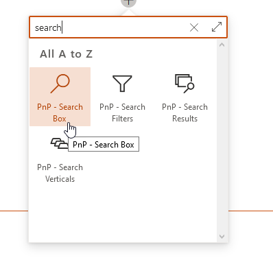
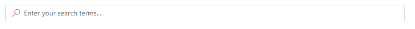
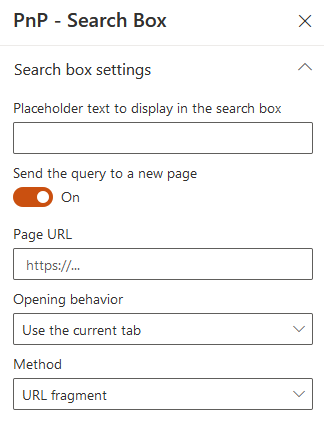
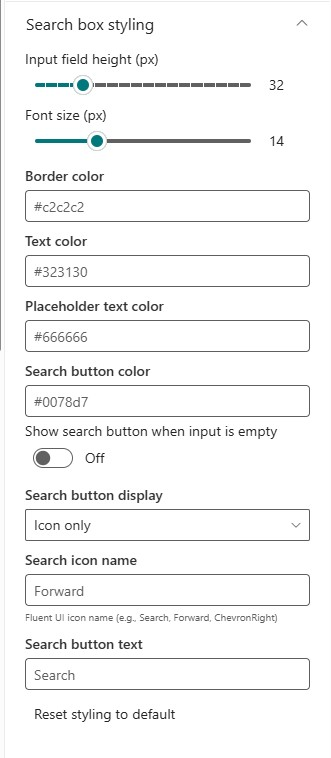
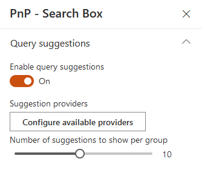
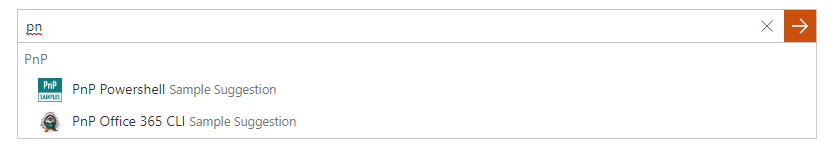
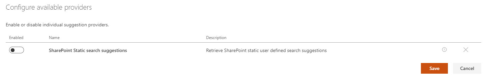
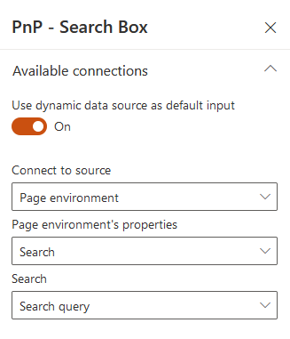

# Search box Web Part

The 'Search box' Web Part allows users to enter free text search queries connected to a 'Search Results' Web Part.

The input uses compact SharePoint styling with small, 2-pixel corners, a theme-aware border and focus outline, and an inset search button. Its default height is 32 pixels; an explicitly configured height or color still takes precedence. The advanced scope icon stays inside the same input outline. Suggestions and search behavior are unchanged.

{: .center}

{: .center}

## Configuration

### Search box settings

{: .center}

| Setting | Description | Default value |
| ------- |---------------- | ---------- |
| **Placeholder text** | The placeholder text to display in the search box. | _"Enter your search terms..."_
| **Query input transformation template** | Query that will be sent to the page as URL fragment (`#`) | Search box keyword entered by the user.
| **Send the query to a new page** | Sends the search query text to a new page. From here you can select the page URL, the open behavior and send method (URL fragment '#' or a query string parameter). The input value can be transformed before sending it to another page. `{inputQueryText}` is replaced with the value from the search box and [other tokens](../search-results/tokens.md) are also supported. | False.
| **Reset query on clear** | Sends a new search query request when the search box is cleared. | True.

### Advanced Search box

**Advanced Search box** enables users to choose between normal free-text/KQL search (**All**) and scopes that search a specific SharePoint Search managed property. It is **Off** by default.

Selecting a scope adds its localized label followed by a colon to the search text, for example **Case ID:test***. The label is a protected prefix: it identifies the selected scope but is not part of the editable text, query suggestions, submitted search text or URL text parameter. Selecting **All** removes the prefix without changing the entered text.

#### Scope configuration

Use **Configure search scopes** to define the available property-specific searches:

| Setting | Example | Description |
| ------- | ------- | ----------- |
| **Scope key (URL value)** | `caseId` | Stable, unique identifier. Use letters, digits, underscores or hyphens, starting with a letter or underscore. `all` is reserved. Keys in URLs are case-sensitive; configured keys must also be unique ignoring case. |
| **Display label** | `CaseId` | Text shown to users in the scope selection popup. |
| **Queryable managed property** | `zfm_CaseNumber` | The SharePoint managed property to search. Use its internal name, beginning with a letter or underscore and containing only letters, digits or underscores. The property must be queryable in the search schema. |
| **Translations** | `da-DK`: `Sagsnummer` | Optional display labels for individual UI languages. Clearing a translated label removes that translation. |

**Queryable managed property** offers the combined **Selected Properties** from all Search Results web parts connected to this Search Box. Custom entries are not accepted. To make another property available, add it to a connected Results web part's Selected Properties and reopen the Search Box settings. Existing scope values are preserved if a property is later removed from Selected Properties. Inclusion in Selected Properties does not confirm queryability; verify that the property is queryable in the search schema.

Translated labels use SharePoint's current UI language, matched case-insensitively against language codes such as `da-DK` or `en-US`. If no translation matches, the **Display label** is used. Translations affect only the displayed scope name, not scope keys, URL values or managed property names. Existing scopes require no migration.

For example, configure `caseId` / `CaseId` / `zfm_CaseNumber` and `customer` / `Customer` / `RefinableString10`. Selecting **CaseId** and submitting `23432432` publishes `zfm_CaseNumber:"23432432"` to the connected Search Results web part. Connect Results to this Search Box as its input query text and use `{inputQueryText}` in the SharePoint Search query template.

#### Search behavior

Property searches use SharePoint's word/phrase matching, subject to managed-property tokenization. A single trailing `*` enables prefix matching, for example `203004*` produces `zfm_CaseNumber:"203004*"`. A phrase can have a wildcard on its final word, such as `Contoso Son*`. Leading, embedded, repeated and standalone wildcards are rejected, as are double quotes, backslashes and curly braces. Token expressions such as `{QueryString.extra}` are not supported in property-scoped values, preventing later token expansion from changing the query restriction. These are not arbitrary substring searches and do not guarantee exact identifier matching. Wildcard support also depends on the managed property's data type; numeric properties do not support text prefix matching. **All** retains normal query syntax. This mode targets SharePoint Search; it does not translate property names or queries for other data sources.

Selecting a scope in the popup alone does not run a search. Press Enter, select a suggestion, or use the Search button to submit the text with the selected scope. Clearing the input removes the query restriction but retains the selected scope.

#### URL state

Advanced mode reads and writes two configurable query-string parameters:

- **Search text URL parameter**: `q` by default.
- **Search scope URL parameter**: `scope` by default.

For example:

```text
?q=23432432&scope=caseId
```

Opening this URL restores both the raw input and the selected scope. A missing scope selects **All**. An unknown scope key also selects **All** and searches with the raw text parameter, but displays a warning below the Search Box. The unknown scope remains in the URL until the next search submission. Submitting preserves unrelated parameters and the URL fragment; clearing removes only the text parameter. Back/Forward navigation restores the submitted search. Duplicate values for either parameter, unsupported property-search values, or invalid configuration still display an error without submitting a fallback query.

In advanced mode these parameters replace the legacy input dynamic-data connection and URL-fragment behavior. **Send the query to a new page** sends raw text and the scope key using these same parameter names; configure the destination Search Box with matching parameter names and scope keys. The legacy query input transformation is not applied in advanced mode. Turning advanced mode off restores the existing Search Box configuration and behavior.

### Search box styling

{: .center}

The search box styling section allows you to customize the visual appearance of the search box to match your branding and design requirements.

Both the standard input and the suggestion-enabled input use rounded corners and a thin, theme-colored magnifying glass to match the modern SharePoint search appearance. When text is present, a back-arrow-style clear button appears on the left and the Search button appears on the right. The arrow retains the existing clear/reset behavior. The Search button uses the thin magnifying glass by default; an explicitly configured button icon still takes precedence.

| Setting | Description | Default value |
| ------- |---------------- | ---------- |
| **Font size** | Controls the font size (in pixels) for both the input text and search button. This provides a unified font size across the entire search box. | _14px_
| **Input field height** | The height (in pixels) of the search input field. | _32px_
| **Border color** | The border color of the search box. | _Theme primary color_
| **Border radius** | The border radius (in pixels) for rounded corners. | _2px_
| **Background color** | The background color of the search input field. | _White_
| **Text color** | The color of the text entered in the search box. | _Theme text color_
| **Placeholder text color** | The color of the placeholder text when the search box is empty. WCAG AA compliant default ensures 4.5:1 contrast ratio. | _#605e5c (WCAG AA compliant)_
| **Search button color** | The background color of the search button. | _Theme primary color_
| **Show search button when input is empty** | Display the search button even when the search input field is empty. | False
| **Search button display** | Choose how the search button appears: Icon only, Text only, or Both (text with icon). | _Icon only_
| **Search icon name** | The Fluent UI icon name to display on the search button (e.g., Search, Forward, ChevronRight). See [Fluent UI Icons](https://developer.microsoft.com/en-us/fluentui#/styles/web/icons) for available icons. | _Search_
| **Search button text** | The text to display on the search button when using "Text only" or "Both" display modes. | _"Search"_
| **Reset styling to default** | Reset all styling options to their default values. | N/A

### Web part title styling

The title styling section allows you to customize the visual appearance of the web part title.

| **Setting** | **Description** | **Default value**
|------------|---------------- | ----------
| **Title font** | The font family to use for the web part title. | _Segoe UI_
| **Title font size** | Controls the font size (in pixels) for the web part title. | _16px_
| **Title font color** | The color of the web part title text. | _Theme primary color_
| **Reset title styling to default** | Reset all title styling options to their default values. | N/A

### Query suggestions

{: .center}

The query suggestions allows users to easily find relevant query keywords based on their entry:

{: .center}

| Setting | Description | Default value |
| ------- |---------------- | ---------- |
|**Enable query suggestions**| Enable or disable query suggestions. | False.
|**Configure available providers** | Enable or disable the suggestions providers available for this Web Part. By default, only the _"SharePoint Static search suggestions"_ is available (disabled by default). <p align="center">[](../../assets/webparts/search-box/suggestions_providers_panel.png)</p> To add values for this provider, refer to the following [documentation](https://docs.microsoft.com/en-us/sharepoint/search/manage-query-suggestions) (caution: it can take up to 24h for changes to take effect). Multiple providers can be enabled at once.
|**Number of suggestions to show per group**| The number of suggestions to show per group. | 10.

### Connections

{: .center}

Optionally, you can set a default query text coming from an other dynamic data source on the page. For instance, connect the search box to a page environment variable like a query string parameter. The value retrieved from a connected data source will be displayed automatically at page load in the text box if present and broadcasted to any other Web Parts connected to the search box Web Part (ex: a 'Search Results' Web Part) resulting to a cascading effect.

You can also connect the Search Box to a Search Verticals Web Part. The current vertical (`key`, `name`, and `value`) is passed to custom suggestion providers through the optional `ISuggestionProviderContext` argument. Switching verticals refreshes visible query suggestions and invalidates cached zero term suggestions without changing the submitted search query. See [Custom suggestions providers](../../extensibility/custom_suggestions_provider.md#use-the-selected-vertical) for an implementation example.

### Audience Targeting

You can control the visibility of the search box based on user group membership. See [Audience Targeting](../search-results/common/audience-targeting.md) for details.
