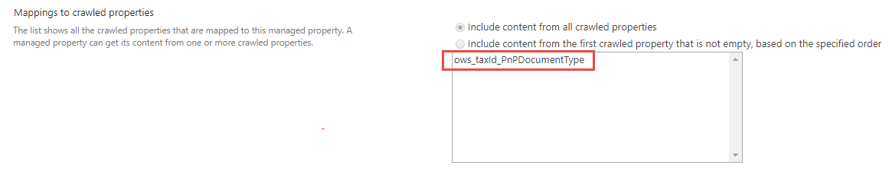

The _'SharePoint Search'_ data source retrieves items from the SharePoint search engine.

> The SharePoint search is different from the Microsoft Graph search.

#### Source configuration

| Setting | Description | Default value 
| ------- |---------------- | ---------- |
| **Query text** | The input query text to pass to the search engine. This setting is not configurable directly in the data source options. To enable it, go to the third configuration page of the Web Part and select either a static or dynamic value (Ex: from a connected search box Web Part). See [the connection documentation](../../search-results/connections/index.md) for more information on how to configure this option. This value can be then used in the **Query template** using the `{searchTerms}` token. Also this value can be a [Keyword Query Language expression (KQL)](https://docs.microsoft.com/sharepoint/dev/general-development/keyword-query-language-kql-syntax-reference). | None.
| **Query template** | The search query template to use. It allows you to use dynamic tokens according to the context or specify conditions that should always apply to the query. | `{searchTerms}`
| **Result source ID** | Can be either a built-in result source ID listed in the dropdown, or a custom result source that you specify. Type the `GUID` of the result source, or the `SCOPE` and `NAME`, separated by `\|` (pipe character). For this to take effect, you must press _'Enter'_ to save the value. Valid scopes are `SPSiteSubscription`, `SPSite`, `SPWeb`. Examples: <ul><li>SPWeb`\|`Local News</li><li>SPSite`\|`Contracts</li><li>SPSiteSubscription`\|`Intranet</li></ul> | LocalSharePointResults
| **Selected properties** | The SharePoint managed properties to retrieve from the results. They can be used with the same name in layouts and slots afterwards. <b> Please be aware that the way we get the list of managed properties is not reliable and you might have to enter the property name manually. To add other managed properties to the list, clear out the dropdown list field and manually type or paste the name of your managed property and press ENTER</b>. This will add it to the list of selected properties in the query. Pasting a comma separated list of property names also work. You can validate the property is working by using the [Debug](../layouts/#debug) layout. If a list of properties is not shown, enter manually.| <ul><li>Title</li><li>Path</li><li>DefaultEncodingURL</li><li>FileType</li><li>HitHighlightedProperties</li><li>HitHighlightedSummary</li><li>AuthorOWSUSER</li><li>owstaxidmetadataalltagsinfo</li><li>Created</li><li>UniqueID</li><li>NormSiteID</li><li>NormListID</li><li>NormUniqueID</li><li>ContentTypeId</li><li>UserName</li><li>JobTitle</li><li>WorkPhone</li><li>SPSiteURL</li><li>SiteTitle</li><li>CreatedBy</li><li>HtmlFileType</li><li>SiteLogo</li></ul>
| **Sort settings** | Configure the sort settings of the data source. The dropdown combines configured sort fields, selected properties, discovered managed properties, and built-in suggestions. Suggestions are not necessarily sortable; see [SharePoint sort checks](#sharepoint-sort-checks) below for their status. You can also type a field name or alias and press 'Enter', or use dynamic tokens in sort field values. For a particular field, you can define if it should be used for initial sort (i.e. when the results are loaded for the first time) or be only available for users in the sort control (i.e. after the results are loaded). **The sort control does not consider default sort fields (i.e. select them by default) and you can only sort on a single field at a time according the fields you defined**. If no user sort fields are defined in the configuration, the sort control won't be displayed.  | None.
| **Refinement filters** | The initial refinement filters to apply to the query. Filters has to be written using FQL ([Fast Query Language](https://docs.microsoft.com/sharepoint/dev/general-development/fast-query-language-fql-syntax-reference)) (e.g. `FileType:equals("docx")`). They will be applied every time to the current search query regardless selected filters from connected Web Parts. Note: for string expressions, use `"` instead of `'`. | None.
| **Language of the search request** | The language to use for the search request. By default the search request will be made using the current user interface language. This parameter is mainly used to process diacritics, plurals, etc. correctly according to the language. | Current UI language.
| **Enable query rules** | Whether or not apply SharePoint query rules. | False.
| **Trim duplicates** | A Boolean value that specifies whether duplicate items are removed from the results. | False.
| **"Cache timeout** | Number of minutes before the cache expires. Set it to 0 to disable caching. | 0.
| **Enable audience targeting** | Whether or not results should be targeted according to the audiences that the current user belongs to. [More information about modern audiences and how to configure them](https://support.microsoft.com/office/target-navigation-news-and-files-to-specific-audiences-33d84cb6-14ed-4e53-a426-74c38ea32293). | False.
| **Enable localization** | If enabled, the Web Part will try to translate the taxonomy term IDs found in result item properties and refinement values to their corresponding label according to the curent UI language. To get it work, you must map a new refinable managed property associated with `ows_taxId_` crawled property and turn this toggle 'on':  If enabled and depending on how many items are currently being displayed, this could slightly decrease the loading performance.   **To use translated values in your template, you must use the '`Auto + <property_name>`' property format instead of the original property name**. For instance, to use translated values of the '_owstaxidmetadataalltagsinfo_' property, you must use the '**Auto**owstaxidmetadataalltagsinfo' auto created property.   If disabled, taxonomy refinement values indexed with different labels (for instance from sites with different default languages) are merged per term and always displayed using the term store default language label, regardless of the page language.   | False.
| **Hit-highlighted properties** | The list of SharePoint managed properties (separated by a comma) to return hit highlighted information (whether the search query match each specified managed property or not).
<b>Note:</b> **HitHighlightedProperties** will be null if there is a field in **Hit-highlighted properties** doesn't exist in  **Selected properties** 
 | None. 
| **Collapse specification** | The CollapseSpecification property takes a Spec parameter that can contain multiple fields separated either by a comma or a space, which evaluated together specify a set of criteria used for collapsing. [More information about the CollapseSpecification](https://learn.microsoft.com/en-us/sharepoint/dev/general-development/customizing-search-results-in-sharepoint#collapse-similar-search-results-using-the-collapsespecification-property). | None.

#### SharePoint sort checks

Opening a sort field dropdown discovers additional managed properties and tests up to 100 candidate fields against a wildcard SharePoint Search query from the current site. Configured sort fields and selected properties are prioritized. Each field is tested in its own `SortList` request, with at most four field checks running concurrently. A rejected sort request also triggers one shared query without sorting to confirm that the underlying query works; this baseline is reused for the page session. The dropdowns share the results for the current property-pane configuration.

For a particular field, add it to the sort configuration, then reopen the property pane. Configured sort fields get checked first.

Saved field-name casing is preserved without losing check status. Successful and in-flight baseline requests are shared; failed baselines are retried by subsequent checks, so a temporary failure does not require reloading the page.

Hover over the status icon for its label:

- **Verified**: SharePoint accepted the sort request and returned a valid search response, even if there were no matching items.
- **Not sortable: SharePoint rejected sorting by this property.**: SharePoint rejected the sort request with HTTP 400 while the same query without sorting succeeded. This identifies a rejected sort field, not an authoritative schema flag.
- **Not checked**: the field was outside the check limit or could not be tested as a literal property name, for example a dynamic token.
- **Check failed**: the request failed for another reason, the unsorted baseline failed, or a response was invalid. Permissions, throttling, and network errors are not classified as non-sortable properties. Failure details are logged in the browser console.

These checks use the current user's search access, not the configured result source, query template, or filters. They are observations, not authoritative search schema settings or refiner checks. All suggestions remain selectable, and existing settings, manual field names, aliases, and dynamic tokens are preserved. If managed-property discovery fails, configured fields and built-in suggestions remain available. Microsoft Search sort settings are unchanged and do not use these SharePoint checks.
