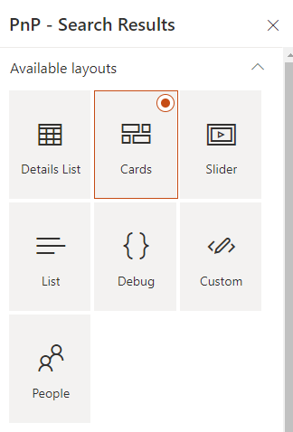
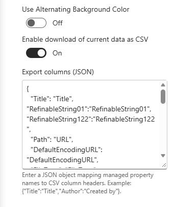
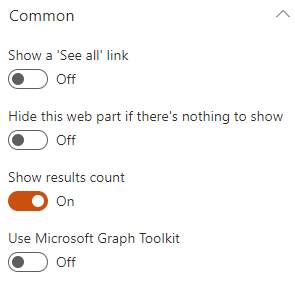
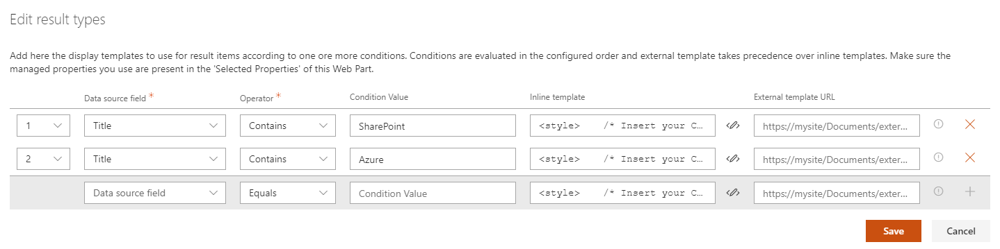
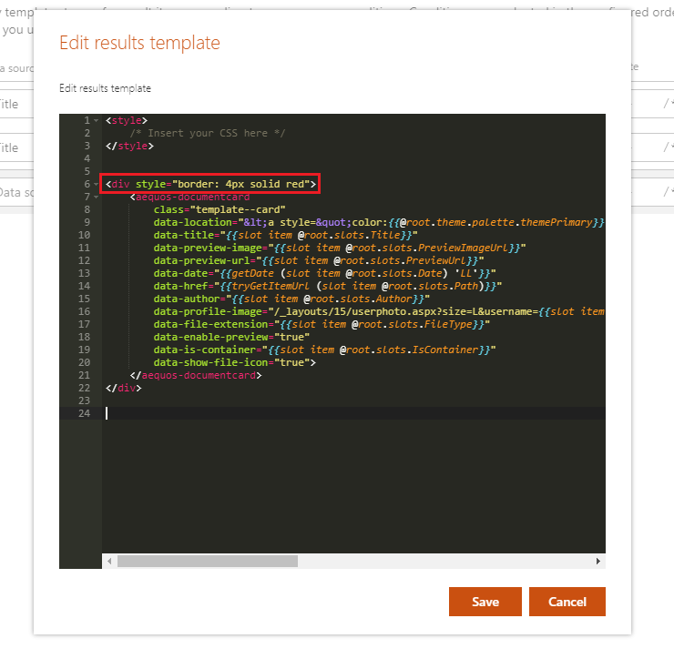
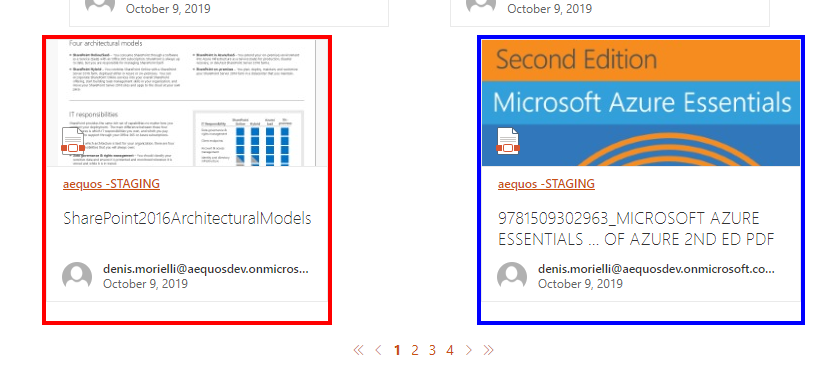

## Builtin layouts

By default, the following layouts are provided:

{: .center}

> Be careful, when you switch the layout in the property pane, all the previous layout properties are lost. We do this to avoid polluting the Web Part property bag with multiple useless configurations.

### Cards

{!usage/search-results/layouts/cards.md!}

### Details List

{!usage/search-results/layouts/details-list.md!}

### Slider

{!usage/search-results/layouts/slider.md!}

### Simple list

{!usage/search-results/layouts/simple-list.md!}

### People

{!usage/search-results/layouts/people.md!}

### Debug

{!usage/search-results/layouts/debug.md!}

### Custom

{!usage/search-results/layouts/custom.md!}

## Common settings

### Export search results to CSV

The built-in Handlebars **Cards**, **Details List**, **Simple list**, and **Slider** layouts support the **Export Search result** action. Adaptive Cards layouts do not expose the export action or its settings. Export uses the current query, applied filters, selected vertical, and sorting from the Results web part's data source. It retrieves additional pages independently of the displayed page size, so it is not restricted to the visible page or selected items.

#### Configuration

1. Edit the Search Results web part and open its **Layouts** property-pane page.
2. Enable **Enable download of current data as CSV** in the selected layout's settings. This toggle is off by default. It appears after **Enable download**, or after **Use Alternating Background Color** in Details List.
3. In the **Export columns (JSON)** textbox that appears below the toggle, enter a JSON object mapping data-source property names to CSV column headers.
4. Ensure the mapped properties are returned by the data source. For SharePoint Search, include the managed properties in **Selected properties**; the export mapping does not add them to the search request automatically. Select **Validate JSON** below the textbox to check the JSON mapping and confirm that every mapped property is selected. A dialog reports success or lists validation errors. This button is shown only when CSV export is enabled.
5. Save the configuration. Users can then select **Export Search result** in the Results toolbar without selecting individual items or enabling **Allow items selection**.

{: .center}

Example:

```json
{
  "Title": "Title",
  "AuthorOWSUSER": "Created by",
  "Created": "Created date",
  "Path": "URL"
}
```

Keys are the property names returned in the result data, not display names or Handlebars expressions. Values are the CSV headers. The mapping is independent of Details List's **Manage columns** configuration. Use one JSON object, not an array of objects. It must contain at least one entry, with non-empty property names and non-empty string headers. Validation runs when the textbox loses focus and checks that every key appears in the data source's selected properties, using exact field names. If any are missing, an error lists them; add those fields to the selected properties or remove them from the export mapping. The mapping does not add missing fields automatically.

The action is disabled when results are loading, when there are no loaded results, when no usable export mapping is configured, and while export is running.

Successful exports do not display a status message. If export fails, a localized, dismissible error is announced to assistive technologies. Changing the search inputs, filters, vertical, sorting, or paging during export cancels it and discards collected rows to avoid mixing results from different queries. Retry the export for the updated search.

Selecting or deselecting result items does not cancel a full-dataset export. The active export and its busy/error state are retained when selection updates replace the toolbar, preventing duplicate exports and allowing the original download to finish.

#### Exported file

- The file is named `SearchResults_<timestamp>.csv`.
- CSV fields are separated by semicolons. Headers and non-null values are quoted, with embedded double quotes escaped; commas, semicolons, and line breaks in values are preserved.
- String values and headers that could be interpreted as spreadsheet formulas are prefixed with an apostrophe, including formula markers following whitespace or control characters. Actual numeric values are preserved as numbers in the CSV text.
- The file uses UTF-8 with a byte order mark (BOM), helping Excel recognize accents and non-English characters.
- Export uses property values from the data source, including its preview enrichment. It does not evaluate layout column HTML or Handlebars expressions, reformat date strings, or perform additional taxonomy-label extraction. Missing or null values produce empty cells; objects and arrays are serialized as JSON text.

Export fetches results using the data source's reported result count, in batches of up to 500. Microsoft Search message and event searches use batches of 25 to comply with Graph paging limits. Search API limits, throttling, count estimates, and changes to indexed content can affect the exported dataset. Large exports take longer and are assembled in browser memory; the reported result count is not a guarantee of an exact row count.

#### Compared with selected-item downloads

**Export Search result** exports the current matching dataset across pages using **Export columns (JSON)**. It does not require item selection.

The existing **Enable download** setting remains separate. With item selection enabled, **Download selected as CSV** exports only selected list items from the current page; documents and folders use the existing file/ZIP download behavior instead.

### Other common settings

For all layouts, some common settings are available:

{: .center}

| Setting | Description | Default value 
| ------- |---------------- | ---------- |
| **Allow items selection** | If enabled, allow items to be selected in default layouts. See [documentation](../connections/item-selection.md) for usage. | Disabled.
| **Allow multiple selection** | If the item selection is allowed, specify if users can select multiple items. When a layout also has **Enable details** turned on, the same **Details** action is reused for both modes: single selection opens the SharePoint details panel for that item, while multiple selection opens the shared selected items edit panel for the compatible selected items. | Disabled.
| **Preserve selection on empty click** | If the item selection is allowed, specify if a click outside of the selection zone should clear the selection | Disabled.
| **Hide this web part if there's nothing to show** | If there is no results, the Web Part will remain blank in display mode (title and 'See all' link included). In edit mode, you will see a message indicating there is no results. <p align="center"></p> | Disabled.
| **Show results count** | Hide or display the results count for the current query. | Enabled.
| **Use Microsoft Graph Toolkit** | Enable or disable the Microsoft Graph Toolkit to be used in Handlebars template. Refer to the [MGT documentation](https://docs.microsoft.com/en-us/graph/toolkit/overview) to see available components.

### Result types

The result types feature gives you the ability to apply a conditional rendering at item level according to data source field values.

{: .center}

> Not all layouts support the result types feature (ex: Details lsit and slider layouts).

**Example**

Given the following conditions, we apply a border with a specific color for each: 

{: .center}

{: .center}

The result would be like this:

{: .center}

The following operators are supported:

- Equals
- Not equals
- Contains
- StartsWith
- Greater Or Equal
- Less Or Equal
- Less than
- Greater than
- Is not null

In case you use a custom template, you can still benefit from this feature following this markup:

```html
{{#> resultTypes}}
  {{!-- The block below will be used as default item template if no result types matched --}}
  <div class="template_result">
      <!-- Your default template markup -->
  </div>
{{/resultTypes}}
```

Handlebars [partials](https://handlebarsjs.com/guide/partials.html) are used behind the scenes and conditions are built dynamically using a recursive if/else structure.
